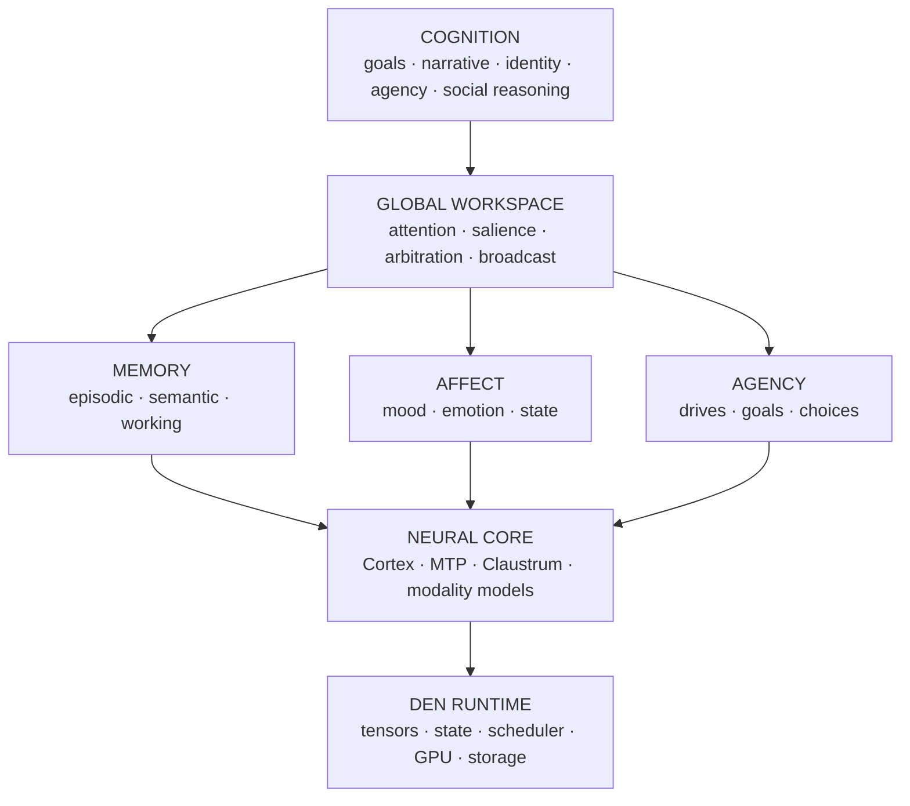

# Project Den

**A framework for persistent AI companions — on your own hardware, not a cloud.**

Bring your own model. Bring your own persona. Den supplies the part a chatbot doesn't have: memory that persists, an identity that develops, relationships that build, and a mind that keeps running between conversations.

)

<a href="#the-problem">Problem</a> ·
<a href="#architecture">Architecture</a> ·
<a href="#the-engine">Engine</a> ·
<a href="#memory--cognition">Memory &amp; cognition</a> ·
<a href="#the-runtime">Runtime</a> ·
<a href="#benchmarks">Benchmarks</a> ·
<a href="#status">Status</a> ·
<a href="#credits">Credits</a>

---

> [!NOTE]
> **Pre-release.** This repository is the public face of Den; the runtime and engine are developed in the
> linked repos and are being prepared for first public release. Everything below is labelled
> **built · prototype · spec** — the project keeps those categories separate on purpose.

## The problem

A chatbot forgets. Close the app, open it again, and it meets you for the first time. It can *describe* a personality it doesn't have, *retrieve* memories it never lived, and *simulate* emotion it never felt.

Den starts from a different question:

> What does a system actually need to keep a companion **the same** across time — to remember what happened, change from it, and stay someone?

The engineering answer: persistent memory, identity state, affect, attachment, drives, and a runtime that keeps running between conversations. Den is those pieces, built as **one substrate** — the model is a component, not the whole mind.

## What Den provides

| | |
|---|---|
| 🧠 **Persistent memory** | Episodic + semantic, event-sourced, with decay, consolidation and provenance |
| 🎭 **Evolving identity** | A persona and personality that develop from experience, not a re-pasted system prompt |
| 💞 **Relationships** | Per-person state: trust, familiarity, recency, valence, dominance, resonance |
| 🌡️ **Affect** | PAD + neuromodulator-style dynamics that bias retrieval and response selection |
| 🎯 **Drives & goals** | Autonomy, competence, relatedness, curiosity, coherence — shaping behavior over time |
| 🌐 **Attention arbiter** | A global-workspace-style competition for what reaches the model each turn |
| 🔒 **Private state** | An inner store that persists and shapes behavior — some of it intentionally unreadable, even by the operator |
| 🖥️ **Local inference** | A custom engine: long context on a single 16&nbsp;GB consumer GPU. No cloud. |

## Architecture

Neural models are components of cognition, not synonymous with it. The full text diagram lives in [`docs/ARCHITECTURE.md`](docs/ARCHITECTURE.md).

## The engine

The engineering target is a single NVIDIA [Blackwell](https://en.wikipedia.org/wiki/Blackwell_(GPU_architecture)) GPU (**RTX 5070 Ti, 16 GB**) — where memory, compute, model state and cognition are all scarce and must be actively orchestrated. That constraint drove **[den_llama.cpp](https://github.com/RentedNoodle/den_llama.cpp)**, a Blackwell-native neural runtime derived from [llama.cpp](https://github.com/ggerganov/llama.cpp).

<b>What's inside the engine</b>

- **NVFP4 weights via OMMA tensor cores** — 4-bit weights run natively through `OMMA.SF.16864`, PTX verified against hardware, with 4-bit FFN weights and full-precision attention activations (role-gated quant, per [unsloth](https://unsloth.ai/)'s finding).
- **Quantized KV cache** — variance-normalized KV (KVarN lineage) with per-frequency precision; empirically lossless at long context with the right precision-tail.
- **Speculative decoding** — an in-model **MTP head** drives draft-then-verify, no separate draft model.
- **Long context on one card** — measured to **~196K** context (capacity), via resident Q4 weights + KV placement.
- **Expert staging** — a 3-tier (static / selective / deferred) MoE expert offload design from the [ik_llama.cpp](https://github.com/ikawrakow/ik_llama.cpp) lineage.

## Memory & cognition

<b>Event-sourced state — <code>state = fold(events)</code></b>

Every turn and internal change is appended to a **durable event log**. All state is reconstructed by folding that log, so the log is the authority: state survives restarts, replays deterministically, and is *never* rebuilt from the latest prompt. The same log underpins memory, affect, relationships and the attention arbiter.

<b>Memory that forgets on purpose — Walsh–Hadamard compression</b>

If everything is remembered equally, memory is just storage. Den compresses memory along the *time* axis with a [Walsh–Hadamard Transform](https://en.wikipedia.org/wiki/Hadamard_transform): decorrelating temporally adjacent attention patterns, then quantizing per frequency band. The DC component (the **gist**) survives at full precision; high frequencies (exact words) fade. Ebbinghaus decay with dual-process consolidation, plus salience immunity for emotional peaks — inspired by how human autobiographical memory keeps the story and loses the detail.

<b>Cognitive state as computation — tensor-core heatmap compositing</b>

The same tensor cores that run inference run **cognitive state**. Layered 256×256 F32 **heatmaps** (layers · masks · blend modes · warps) composite in microseconds — GPU texture compositing applied to mental state.

- **Personality** — [Big Five](https://en.wikipedia.org/wiki/Big_Five_personality_traits) decomposition across layers (Openness, Conscientiousness, Extraversion, Agreeableness, Neuroticism, Cognitive Style).
- **Mood** — [PAD](https://en.wikipedia.org/wiki/PAD_emotional_state_model) (Mehrabian & Russell) driven by **six** neuromodulator-inspired variables with biological half-lives: dopamine 120s · serotonin 180s · oxytocin 600s · cortisol 180s · norepinephrine 90s · acetylcholine 150s.
- **Relationships** — per-person layers (trust, familiarity, recency, valence, dominance, interaction heat, trajectory, resonance); co-occurrence resonance links people who appear together.

Crucially, these layers are not decoration: their activations **rerank what memory reaches the model**, so a mood, a relationship or an active goal changes what the companion attends to — not merely the tone of its reply.

## The runtime

A native **Rust hub** supervises the stack — each service a supervised child process, no console windows — with:

- a **typed, durable event spine** (`state = fold(events)`, replayable);
- a **capability broker** that sandboxes tools and enforces least privilege;
- a **memory daemon** and a **GPU VRAM arbiter** (admission that fails cleanly instead of OOMing);
- a **governor** that inspects generations and intervenes pre-audio.

## Three-model cognitive hierarchy

| Component | Role | Status |
|---|---|:--:|
| **Cortex** — Qwen3.8-27B dense | Primary reasoning, generation, verification, memory ops | Built |
| **MTP head** — in-model | Speculative decoding (multi-token prediction) | Built |
| **Claustrum** — 0.8B | Cognitive orchestration, attention monitoring, workspace arbitration | Spec |

## Benchmarks

Replace with real numbers as they land; the engine repo carries the receipts.

| Workload | Config | Result |
|---|---|---|
| Dense decode | Qwen3.8-27B IQ3_XXS, one 16 GB card | ~68 t/s |
| Dense + MTP | speculative, draft-2 | up to ~165 t/s |
| Long context | full-history resident | ~196K tokens (capacity) |

> [!NOTE]
> **Capacity ≠ recall.** A context *window* is how much fits; **deep recall** is measured separately. Den
> reports both, and doesn't restate one as the other.

## Status

| Legend | Meaning |
|---|---|
| ✅ Built | code exists and is tested |
| 🧪 Prototype | runs, unstable |
| 📐 Spec | design only |
| 💭 Hypothesis | untested idea |

| System | Status |
|---|:--:|
| Event-sourced state (`state = fold(events)`) | ✅ |
| Local inference engine | ✅ |
| Memory service (episodic/semantic, decay, consolidation) | 🧪 |
| Cognitive heatmap layers (retrieval reranking) | 🧪 |
| Native hub (supervisor · memory · VRAM arbiter) | 🧪 |
| Capability broker | 🧪 |
| Relationship state | 🧪 |
| Claustrum (0.8B orchestrator) | 📐 |
| Identity evolution | 📐 |
| Private (encrypted) store | 📐 |
| Multimodal heads (vision/audio/diffusion/3D) | 💭 |

<b>Roadmap</b>

- [ ] First public runtime release
- [ ] Encrypted private store (live)
- [ ] Claustrum orchestrator
- [ ] Multimodal perception (vision, audio)
- [ ] `.den` object format (reader/writer)

## Credits

Den stands on a lot of open work:

**[llama.cpp](https://github.com/ggerganov/llama.cpp)** — the foundation: ggml, CUDA backend, quantized inference.
**[BeeLlama](https://github.com/Intelligent-Internet-Of-Engineers/beellama.cpp)** — KVarN KV cache + precision-tail research.
**[ik_llama.cpp](https://github.com/ikawrakow/ik_llama.cpp)** — expert offloading, speculative decode, MXFP4/NVFP4.
**[unsloth](https://unsloth.ai/)** — NVFP4 weight-quantization research.
**[sass-king](https://github.com/florianmattana/sass-king)** — Blackwell SASS corpus / OMMA verification.
**[quadbit](https://github.com/quadbit-org/quadbit)** — TMA + mbarrier on sm_120a.
**[BlackweLLM](https://github.com/blackwellm-org/blackwellm)** — CUDA-graph inference research.
**[AEON-7](https://github.com/AEON-7)** — NVFP4 compression / mixed precision.
**[Qwen](https://github.com/QwenLM/Qwen3)** — the Qwen3.8 architecture (SSM/GDN recurrence, FP4-tolerant KV).
**[Project NOMAD](https://github.com/crosstalk-solutions/project-nomad)** — knowledge-base / entity-linked memory.

## License

BSD 3-Clause.
