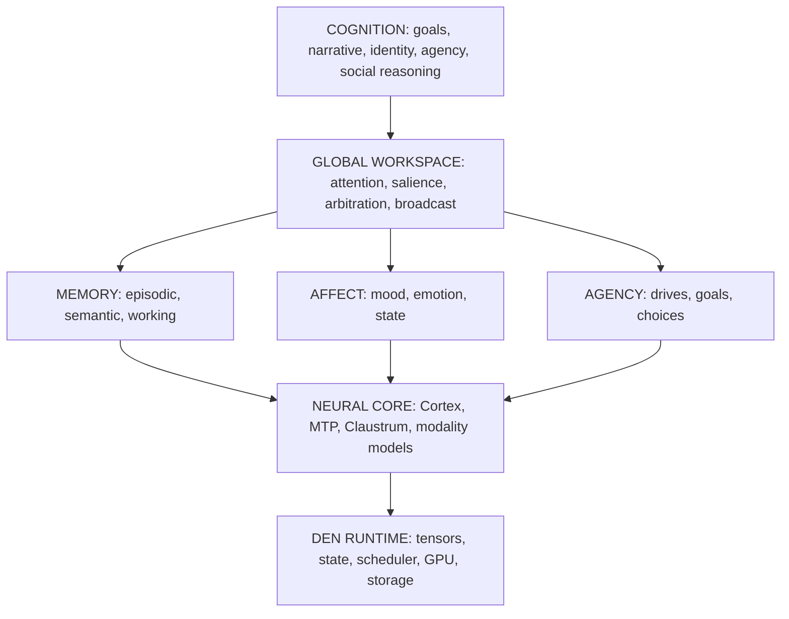

# Project Den

**A framework for persistent AI companions, running on local hardware.**

Bring your own model. Bring your own persona. Den provides the layer a chatbot lacks: memory that persists, an identity that develops, relationships that accumulate, and a runtime that keeps state alive between conversations.

)

<a href="#the-problem">Problem</a> &middot;
<a href="#architecture">Architecture</a> &middot;
<a href="#the-engine">Engine</a> &middot;
<a href="#memory-and-cognition">Memory and cognition</a> &middot;
<a href="#the-runtime">Runtime</a> &middot;
<a href="#benchmarks">Benchmarks</a> &middot;
<a href="#status">Status</a> &middot;
<a href="#credits">Credits</a>

---

> [!NOTE]
> **Pre-release.** This repository is the public face of Den. The runtime and engine are developed in the
> linked repositories and are being prepared for first public release. Every claim below is labelled
> built, prototype, or spec. The project keeps those categories separate.

## The problem

A chatbot is stateless. Close the application, open it again, and it meets you for the first time. It can
describe a personality it does not have, retrieve memories it never formed, and simulate emotion it never
carried. The persona is recomputed from the prompt every turn; nothing accumulates.

Den begins from a different question: what does a system need to hold a companion the same across time, to
remember what happened, change from it, and remain a continuous individual?

The engineering answer is a set of persistent state layers (memory, identity, affect, relationships,
drives) over an event log, with a runtime that keeps those layers alive between conversations. The
language model is one component of the system, not the whole of it.

## What Den provides

| Layer | Description |
|---|---|
| Persistent memory | Episodic and semantic records, event-sourced, with decay, consolidation, and provenance. |
| Evolving identity | A persona and personality that develop from recorded experience rather than a re-pasted system prompt. |
| Relationships | Per-person state: trust, familiarity, recency, valence, dominance, interaction heat, resonance. |
| Affect | A PAD state driven by six neuromodulator-inspired variables with biological half-lives. |
| Drives and goals | Persistent drives (autonomy, competence, relatedness, curiosity, coherence) that select goals over time. |
| Attention arbitration | A global-workspace-style competition deciding what reaches the model each turn. |
| Private state | An inner store that persists and shapes behavior, with a portion intentionally unreadable at rest. |
| Local inference | A custom engine delivering long-context inference on a single 16 GB consumer GPU, offline. |

## Architecture

The model is a component of cognition, not a synonym for it. The full diagram lives in
[`docs/ARCHITECTURE.md`](docs/ARCHITECTURE.md).

## The engine

The engineering target is a single NVIDIA [Blackwell](https://en.wikipedia.org/wiki/Blackwell_(GPU_architecture))
GPU (RTX 5070 Ti, 16 GB), where memory, compute, model state, and cognition are all scarce and must be
actively scheduled. That constraint drove **[den_llama.cpp](https://github.com/RentedNoodle/den_llama.cpp)**,
a Blackwell-native neural runtime derived from [llama.cpp](https://github.com/ggerganov/llama.cpp).

Engine internals

- **NVFP4 weights on OMMA tensor cores.** 4-bit weights execute natively through `OMMA.SF.16864`. The PTX is
  verified against hardware behavior. Quantization is role-gated: 4-bit FFN weights, full-precision attention
  activations (following unsloth's finding that NVFP4 belongs on FFN weights, not attention).
- **Quantized KV cache.** Variance-normalized KV with per-frequency precision in the KVarN lineage. The
  precision tail is tuned to 1024 tokens, which the project's measurements found optimal and empirically
  lossless at long context.
- **Speculative decoding.** An in-model MTP (multi-token prediction) head drives draft-then-verify. No
  separate draft model is required.
- **Long context on one card.** Measured to roughly 196K tokens of context capacity, via resident Q4 weights
  and KV placement.
- **Expert staging.** A three-tier (static, selective, deferred) MoE expert offload design inherited from the
  ik_llama.cpp line.

## Memory and cognition

Event-sourced state: state = fold(events)

Every turn and internal change is appended to a durable event log. All state is reconstructed by folding
that log, so the log is the authority: state survives restarts, replays deterministically, and is never
rebuilt from the latest prompt. Memory, affect, relationships, and the attention arbiter all read from the
same log.

Memory that forgets on purpose: Walsh-Hadamard compression

If everything is remembered equally, memory is storage. Den compresses memory along the time axis with a
[Walsh-Hadamard Transform](https://en.wikipedia.org/wiki/Hadamard_transform): decorrelating temporally
adjacent attention patterns, then quantizing at different rates per frequency band. The DC component (the
gist) survives at full precision; high frequencies (exact wording) fade. Ebbinghaus decay and dual-process
consolidation run on top, with salience immunity for emotional peaks. The design is inspired by how human
autobiographical memory retains narrative and discards detail.

Cognitive state as computation: tensor-core heatmap compositing

The same tensor cores that run inference also run cognitive state. Layered 256x256 F32 heatmaps (layers,
masks, blend modes, warps) composite in microseconds: GPU texture compositing applied to mental state.

- **Personality.** [Big Five](https://en.wikipedia.org/wiki/Big_Five_personality_traits) decomposition across
  layers: Openness, Conscientiousness, Extraversion, Agreeableness, Neuroticism, Cognitive Style.
- **Mood.** [PAD](https://en.wikipedia.org/wiki/PAD_emotional_state_model) (Mehrabian and Russell), driven by
  six neuromodulator-inspired variables with biological half-lives: dopamine 120s, serotonin 180s, oxytocin
  600s, cortisol 180s, norepinephrine 90s, acetylcholine 150s.
- **Relationships.** Per-person layers tracking trust, familiarity, recency, valence, dominance, interaction
  heat, trajectory, and resonance. Co-occurrence resonance associates people who appear together.

These layers are not decoration. Their activations rerank what memory reaches the model, so a mood, a
relationship, or an active goal changes what the companion attends to, not only the tone of its reply.

## The runtime

A native Rust hub supervises the stack, with each service running as a supervised child process.

- **Typed, durable event spine.** State is `fold(events)` and replays deterministically.
- **Capability broker.** Tools are sandboxed and least-privilege; a tool result cannot escalate its own
  permissions.
- **Memory daemon.** Consolidation and retrieval over the event log.
- **GPU VRAM arbiter.** Admission control that degrades cleanly instead of failing on out-of-memory.
- **Governor.** Inspects generations and intervenes before audio is committed.

## Three-model cognitive hierarchy

| Component | Role | Status |
|---|---|:--:|
| Cortex (Qwen3.8-27B dense) | Primary reasoning, generation, verification, memory operations | Built |
| MTP head (in-model) | Speculative decoding via multi-token prediction | Built |
| Claustrum (0.8B) | Cognitive orchestration, attention monitoring, workspace arbitration | Spec |

The Cortex is the live serving model: Qwen3.8-27B (dense), quantized IQ3_XXS, with an in-model MTP head.
The Claustrum, named after the brain structure Crick and Koch proposed as a conductor of consciousness, is
designed but not built.

## Benchmarks

The engine repository carries the receipts. Figures below are for the reference single-GPU target.

| Workload | Configuration | Result |
|---|---|---|
| Dense decode | Qwen3.8-27B IQ3_XXS, one 16 GB card | about 68 tok/s |
| Speculative decode | MTP, draft-2 | up to about 165 tok/s |
| Context capacity | full-history resident | about 196K tokens |

> [!NOTE]
> Context capacity is how much fits. Deep recall is measured separately. Den reports both and does not
> restate one as the other.

## Status

| Label | Meaning |
|---|---|
| Built | code exists and is tested |
| Prototype | runs, unstable |
| Spec | design only |
| Hypothesis | untested idea |

| System | Status |
|---|:--:|
| Event-sourced state (`state = fold(events)`) | Built |
| Local inference engine | Built |
| Memory service (episodic, semantic, decay, consolidation) | Prototype |
| Cognitive heatmap layers (retrieval reranking) | Prototype |
| Native hub (supervisor, memory, VRAM arbiter) | Prototype |
| Capability broker | Prototype |
| Relationship state | Prototype |
| Claustrum orchestrator | Spec |
| Identity evolution | Spec |
| Encrypted private store | Spec |
| Multimodal heads (vision, audio, diffusion, 3D) | Hypothesis |

Roadmap

- [ ] First public runtime release
- [ ] Encrypted private store, live
- [ ] Claustrum orchestrator
- [ ] Multimodal perception (vision, audio)
- [ ] `.den` object format (reader and writer)

## Credits

Den builds on open work. Credits, without license tags, per the project's convention.

**[llama.cpp](https://github.com/ggerganov/llama.cpp)** (Georgi Gerganov): the foundation. ggml, the CUDA
backend, and quantized inference.
**[BeeLlama](https://github.com/Intelligent-Internet-Of-Engineers/beellama.cpp)**: KVarN KV cache and
precision-tail research.
**[ik_llama.cpp](https://github.com/ikawrakow/ik_llama.cpp)** (Ivan Kawrakow): expert offloading,
speculative decode, MXFP4 and NVFP4 inference.
**[unsloth](https://unsloth.ai/)**: NVFP4 weight-quantization research.
**[sass-king](https://github.com/florianmattana/sass-king)** (Florian Mattana): Blackwell SASS corpus and
OMMA instruction verification.
**[quadbit](https://github.com/quadbit-org/quadbit)**: TMA and mbarrier patterns on sm_120a.
**[BlackweLLM](https://github.com/blackwellm-org/blackwellm)**: CUDA graph research for inference.
**[AEON-7](https://github.com/AEON-7)**: NVFP4 compression and mixed precision.
**[Qwen](https://github.com/QwenLM/Qwen3)**: the Qwen3.8 architecture (SSM/GDN recurrence, FP4-tolerant KV).
**[Project NOMAD](https://github.com/crosstalk-solutions/project-nomad)**: knowledge-base and
entity-linked memory architecture.

## License

BSD 3-Clause.
