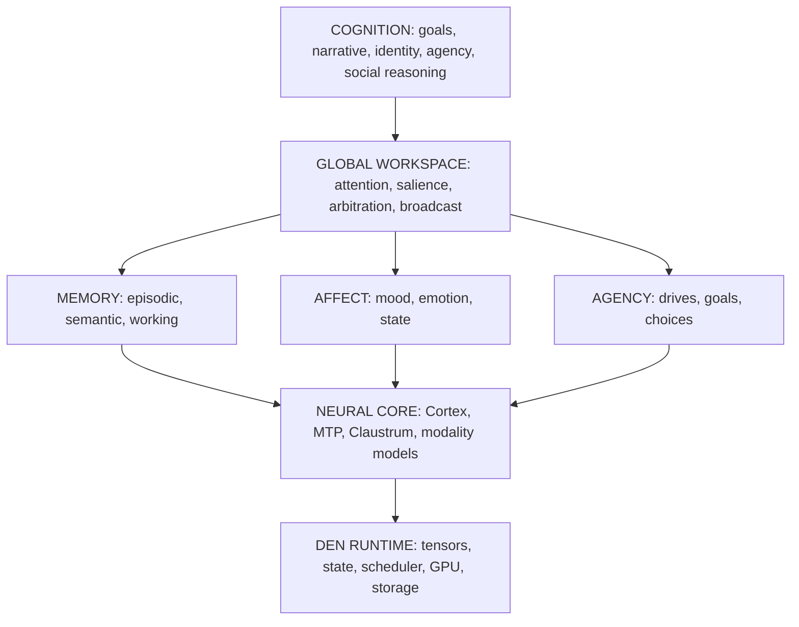

# Project Den

> [!IMPORTANT]
> **Project Den is under active development and has not been released.**
> Public availability is limited to our engine build/source work linked below; the integrated companion/application is not a public release.

**A local-first framework for persistent AI companions.**

Bring your own model. Bring your own persona. Den is being built as a persistent state layer: memory that lasts, identity with continuity, relationships that develop, and a runtime that carries a companion's state between conversations.

)

<a href="#vision">Vision</a> &middot;
<a href="#current-state">Current state</a> &middot;
<a href="#public-availability">Public availability</a> &middot;
<a href="#next-priorities">Next priorities</a> &middot;
<a href="#engine-and-reference-hardware">Engine</a> &middot;
<a href="#architecture">Architecture</a> &middot;
<a href="#memory-and-affect">Memory and affect</a> &middot;
<a href="#technical-references">References</a>

---

## Vision

Den is being built so a companion can remain a recognizable individual across time.

The purpose is persistent individuality: self-continuity, a coherent identity and stable preferences, meaningful memory of shared experience, initiative and follow-through, and a reciprocal presence through voice and eventually an avatar. The language model is one component. The state layer is what lets the same individual return, remember, change from experience, and continue rather than restart.

The target is local hardware: one consumer GPU, offline, with the reasoner and companion state co-resident. That constraint drives the engineering — quantized KV, speculative decoding, careful residency, and a runtime that treats memory and compute as scarce.

## Current state

Den is in active private development. The integrated companion is a prototype.

**Implemented in private development**

- Core identity anchor.
- Evidence-backed memory with provenance; model-agnostic records and a rebuildable local index.
- Accepted preferences with an operator approval path.
- Goals and promises, a turn ledger, and bounded context selection.
- Numeric PAD affect state with local visualization.
- Voice/TTS, ASR, image, and vision paths tested in the private development build.

**In progress**

- Experience-driven layered persona. The core anchor is implemented; full persona layers and evolution are not.
- Initiative and follow-through across sessions.
- Real-model, long-run identity and continuity evaluation.
- Avatar rigging and runtime wiring.
- Offline knowledge indexing. The corpus is downloaded; indexing is partial and retrieval is not complete.
- Larger-context and paged-KV engine work.
- Engine `build2.1`, behind default-off flags and a no-regression gate.

**Planned**

- A public companion runtime, after a future release decision.
- Encrypted private store integrated at runtime.
- Claustrum orchestration layer.
- `.den` object format reader and writer.
- Open-ended generation heads (diffusion, 3D).

## Public availability

- **Engine source and build instructions:** [den_llama.cpp](https://github.com/RentedNoodle/den_llama.cpp). The stable reference is `build2` at commit `abd589d4cf6d4d2d221b9532d3861fadbdb7b046`; `build2.1` is the next line. No downloadable binary assets are currently published on GitHub.
- **This repository:** public design, architecture, and specification documents.
- **Reference model:** [Qwen3.8-27B OrcaRouter on Hugging Face](https://huggingface.co/RentedNoodle/Qwen3.8-27B-OrcaRouter-GSQ-RCO-IQ3_XXS-Uncensored). Weights are a separate artifact and are not stored in the engine repository.
- **Companion application and runtime:** not public.

## Next priorities

1. Complete the experience-driven persona and continuity behavior.
2. Run a real-model, long-run identity and continuity evaluation.
3. Finish memory subsystem unification and define the consolidation policy.
4. Finish the offline knowledge index and cut over only after verification.
5. Rig and wire the avatar, then connect voice and visual presence.
6. Advance the public engine to `build2.1` behind the no-regression gate.
7. Decide whether and when to publish the companion runtime.

Priority order, not a schedule. No release date is announced.

## Engine and reference hardware

The public engine is a Blackwell-native [llama.cpp](https://github.com/ggml-org/llama.cpp) fork for long-context GGUF inference on one 16 GB card. Its stable line is `build2`; `build2.1` is next. Historical `build3` is regressed and superseded, and experimental branches are separate. See the [engine README](https://github.com/RentedNoodle/den_llama.cpp#readme) for branch status, features, build commands, and historical measurements.

Reference target: NVIDIA RTX 5070 Ti, GB203, `sm_120a`, 16 GB; Windows with CUDA 13.3. Reference model: Qwen3.8-27B, dense, IQ3_XXS, with an in-model MTP head. `build2` measured about 196K tokens of context capacity; capacity is not recall, and recall is measured separately. Historical benchmark conditions are published in the [engine benchmarks](https://github.com/RentedNoodle/den_llama.cpp#benchmarks); they are reference-machine results, not integrated-companion performance.

## Architecture

This is the target architecture; implementation status is in Current state. The engineering view is in [`docs/ARCHITECTURE.md`](docs/ARCHITECTURE.md); component specifications are in [`docs/specs/`](docs/specs/); the long-form direction is in [`docs/PROJECT_DEN_VISION.md`](docs/PROJECT_DEN_VISION.md); the long-range [`docs/ROADMAP.md`](docs/ROADMAP.md) is historical, and this README's Current state is authoritative.

## System shape

The private runtime is a native hub.

- **Event spine:** typed, durable records with deterministic replay where eligible.
- **Capability broker:** scoped tool access, operator controls and audit records; isolation and permission handling continue to be developed and tested.
- **Memory service:** consolidation and retrieval hooks over durable records.
- **VRAM arbiter:** admission control that degrades cleanly instead of failing on out-of-memory.
- **Governor:** inspects generations and can intervene before output is committed.

Cognitive tiers:

- **Cortex — Qwen3.8-27B dense.** Primary reasoning, generation, verification, and memory operations. Private development.
- **MTP head — in-model.** Speculative decoding. Public engine implementation.
- **Claustrum — 0.8B.** Orchestration, attention monitoring, and workspace arbitration. Planned, not built.

## Memory and affect

- **Event state:** eligible public events are appended to a durable log and replayed. Private working context is ephemeral. Unifying the newer continuity ledger with the legacy memory subsystems is ongoing.
- **Memory service:** episodic and semantic records, provenance, decay, and model-agnostic local storage. The index is rebuildable.
- **Consolidation:** a full memory consolidation policy is deferred. Current hooks are not complete consolidation.
- **Affect:** a numeric PAD state and local visualization exist in the private build and can modulate behavior.
- **Research, not defaults:** Walsh-Hadamard memory compression and tensor-core heatmap compositing are research experiments. They are not current defaults, and no performance or retrieval benefit is claimed. Retrieval reranking from those layers remains off.

## Technical references

Den is built on and informed by open work. These are references and lineage, not a claim that every mechanism is integrated.

**Foundation:** [llama.cpp](https://github.com/ggml-org/llama.cpp) (ggml, CUDA backend, base engine), [ik_llama.cpp](https://github.com/ikawrakow/ik_llama.cpp) (expert offload, speculative decode, MXFP4/NVFP4 lineage), [Qwen3.8](https://github.com/QwenLM/Qwen3.8) (model architecture), [ISTA-DASLab](https://github.com/IST-DASLab) (GSQ + RCO quantization).

**KV, quantization, and prediction:** [BeeLlama](https://github.com/Anbeeld/beellama.cpp), [Lobo](https://github.com/alectodescent/lobo-qwen38-16gb), [NInfer](https://github.com/Neroued/ninfer), [unsloth](https://github.com/unslothai/unsloth), [KVMem](https://github.com/1314521gjy/ninfer-fusion-kvmem), [adaptive-kv-streaming](https://github.com/RaymondHuang210129/llama.cpp-adaptive-kv-streaming).

**Speculative decode and MoE:** [gem16](https://github.com/Danmoreng/gem16), [Strata](https://github.com/Niko1221/Strata), [z-lab DFlash2](https://huggingface.co/z-lab/Qwen3.8-27B-DFlash2), [PrismML Bonsai](https://huggingface.co/prism-ml/Ternary-Bonsai-2-27B-gguf), [ProCreations DFlash2](https://huggingface.co/ProCreations/Ternary-Bonsai-2-27B-DFlash2).

**Kernels and hardware:** [CUTLASS](https://github.com/NVIDIA/cutlass), [sass-king](https://github.com/florianmattana/sass-king), [NVIDIA Optical Flow SDK](https://github.com/NVIDIA/NVIDIAOpticalFlowSDK), [vcpkg](https://github.com/microsoft/vcpkg).

**Local speech:** [qwentts.cpp](https://github.com/ServeurpersoCom/qwentts.cpp), [Qwen3-ASR](https://github.com/QwenLM/Qwen3-ASR), [Qwen3-TTS](https://github.com/QwenLM/Qwen3-TTS), [audio.cpp](https://github.com/0xShug0/audio.cpp), [qwen3-asr.cpp](https://github.com/predict-woo/qwen3-asr.cpp), [qwen-asr](https://github.com/antirez/qwen-asr), [faster-qwen3-tts](https://github.com/andimarafioti/faster-qwen3-tts), [qwen3-tts.cpp](https://github.com/predict-woo/qwen3-tts.cpp), [qwen3_asr_rs](https://github.com/second-state/qwen3_asr_rs).

**Vision and OCR:** [RapidOCR](https://github.com/RapidAI/RapidOCR), [PaddleOCR](https://github.com/PaddlePaddle/PaddleOCR), [Tesseract](https://github.com/tesseract-ocr/tesseract).

**Cognition and research:** [Global-Workspace-Agents](https://github.com/giansha/Global-Workspace-Agents), [State-of-Thought](https://github.com/GongZhiren/State-of-Thought), [Project NOMAD](https://github.com/crosstalk-solutions/project-nomad).

## License

BSD 3-Clause. See [`LICENSE`](LICENSE).
